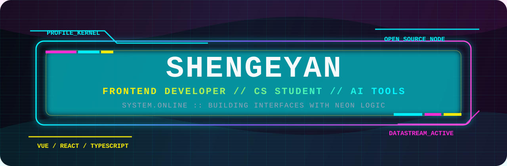

<p align="center">
  
</p>

<p align="center">
  
</p>

<p align="center">
  <a href="./README.md">中文</a> |
  <strong>English</strong>
</p>

<p align="center">
  <a href="https://shengeyan.github.io/">
    
  </a>
  <a href="http://shengeyan.tuanwo.cn/">
    
  </a>
  <a href="mailto:itshengeyan@qq.com">
    
  </a>
</p>

---

## 01 // Identity Node

<table>
  <tr>
    <td width="30%"><strong>CALLSIGN</strong></td>
    <td><strong>ShenGeYan</strong></td>
  </tr>
  <tr>
    <td><strong>ROLE</strong></td>
    <td>Web Frontend Developer / Computer Science & Technology student</td>
  </tr>
  <tr>
    <td><strong>BASE</strong></td>
    <td>Chongqing University of Technology</td>
  </tr>
  <tr>
    <td><strong>MISSION</strong></td>
    <td>Use frontend, AI, and engineering practice to turn ideas into clear, usable, maintainable products.</td>
  </tr>
</table>

I enjoy structured systems with a sharp visual edge. My current work focuses on **Vue 3**, **React**, **TypeScript**, **SSR/SEO**, collaborative tools, and bot-driven workflows.

```txt
> system.status      online
> current.stack      vue3 / react / typescript / node
> focus.area         frontend architecture / ai-assisted workflow
> build.rule         clear structure, useful details, maintainable output
```

---

## 02 // GitHub Datastream

<p align="center">
  
  
  
  
</p>

<p align="center">
  
</p>

<p align="center">
  
</p>

<table>
  <tr>
    <th>DATA</th>
    <th>VALUE</th>
  </tr>
  <tr>
    <td><strong>Main Languages</strong></td>
    <td>TypeScript, JavaScript, Vue, HTML, Python</td>
  </tr>
  <tr>
    <td><strong>Engineering Style</strong></td>
    <td>Frontend architecture, product interaction, automation workflows, AI-assisted development</td>
  </tr>
  <tr>
    <td><strong>Open Direction</strong></td>
    <td>Web apps, resource systems, collaborative experiences, developer tools</td>
  </tr>
</table>

---

## 03 // Tech Arsenal

<p align="center">
  
  
  
  
  
  
  
  
  
  
</p>

---

## 04 // Project Grid

<table>
  <tr>
    <th>MODULE</th>
    <th>OUTPUT</th>
    <th>STACK</th>
  </tr>
  <tr>
    <td><a href="https://github.com/shengeyan/SSR-ResourceHub"><strong>SSR-ResourceHub</strong></a></td>
    <td>Graduation project using SSR to improve SEO for a resource platform.</td>
    <td><code>Vue</code> <code>Nuxt</code> <code>Nest</code></td>
  </tr>
  <tr>
    <td><a href="https://github.com/shengeyan/anyheap-2025"><strong>anyheap-2025</strong></a></td>
    <td>A rebuilt collaborative workspace for draggable materials and synced operations.</td>
    <td><code>TypeScript</code> <code>WebSocket</code></td>
  </tr>
  <tr>
    <td><a href="https://github.com/shengeyan/feishubot"><strong>feishubot</strong></a></td>
    <td>Feishu bot for Codex collaboration tasks and workflow automation.</td>
    <td><code>TypeScript</code> <code>Bot</code></td>
  </tr>
  <tr>
    <td><a href="https://github.com/shengeyan/DRSP-client"><strong>DRSP-client</strong></a></td>
    <td>Frontend for a mini program that analyzes ingredient labels and allergens.</td>
    <td><code>JavaScript</code> <code>Mini Program</code></td>
  </tr>
  <tr>
    <td><a href="https://github.com/shengeyan/Mlysl-UI"><strong>Mlysl-UI</strong></a></td>
    <td>A component library project from ByteDance Youth Training Camp.</td>
    <td><code>TypeScript</code> <code>Vue</code></td>
  </tr>
  <tr>
    <td><a href="https://github.com/shengeyan/FrontMidPlatform"><strong>FrontMidPlatform</strong></a></td>
    <td>Frontend project for a front-middle platform system.</td>
    <td><code>Vue</code></td>
  </tr>
</table>

<p align="center">
  <a href="https://github.com/shengeyan?tab=repositories">
    
  </a>
</p>

---

## 05 // Contact Channel

<table>
  <tr>
    <td><strong>Website</strong></td>
    <td><a href="https://shengeyan.github.io/">https://shengeyan.github.io/</a></td>
  </tr>
  <tr>
    <td><strong>Blog</strong></td>
    <td><a href="http://shengeyan.tuanwo.cn/">http://shengeyan.tuanwo.cn/</a></td>
  </tr>
  <tr>
    <td><strong>Email</strong></td>
    <td><a href="mailto:itshengeyan@qq.com">itshengeyan@qq.com</a></td>
  </tr>
</table>

<p align="center">
  <strong>NEON LOGIC ONLINE // Let's build something interesting.</strong>
</p>
