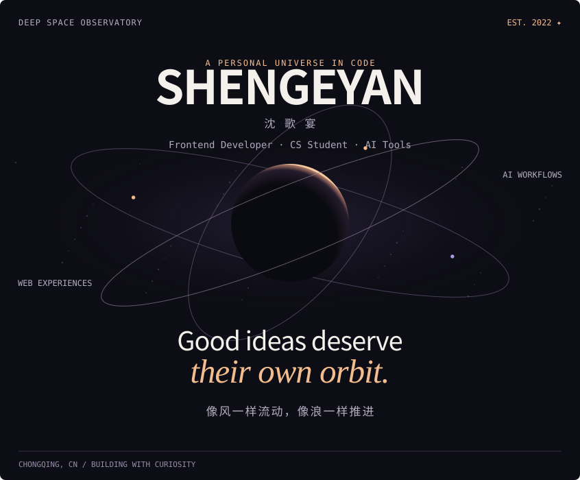
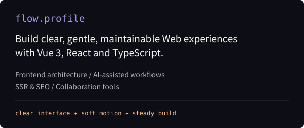
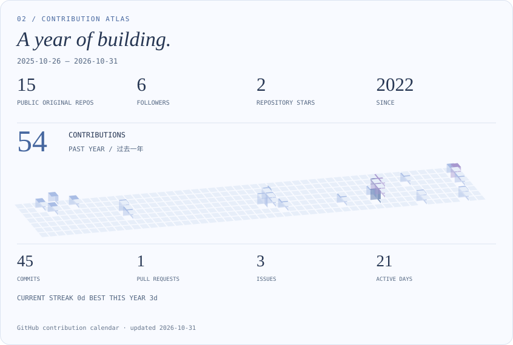
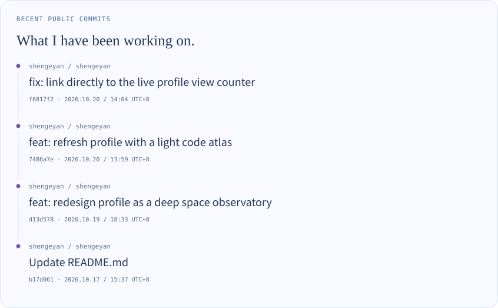
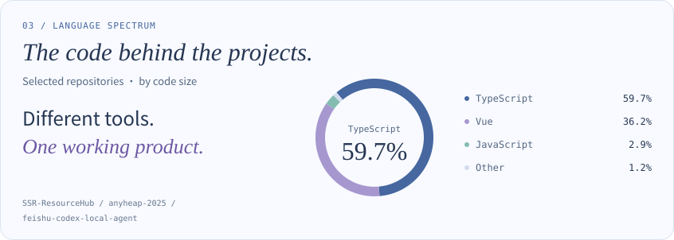
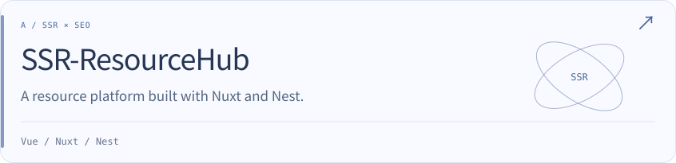
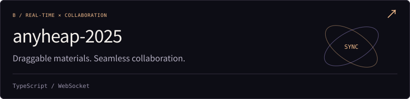
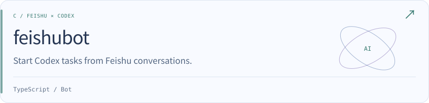
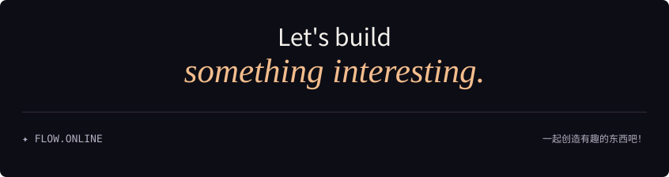

<picture>
  <source media="(max-width: 600px)" srcset="./assets/deep-space/hero-mobile.svg" />
  
</picture>

  

  <a href="./README.md">中文</a> |
  <strong>English</strong>

  
  
  

---

## 01 / Flow Profile

<table>
  <tr>
    <td width="28%"><strong>Name</strong></td>
    <td><strong>ShenGeYan</strong></td>
  </tr>
  <tr>
    <td><strong>Role</strong></td>
    <td>Web Frontend Developer / Computer Science & Technology student</td>
  </tr>
  <tr>
    <td><strong>Base</strong></td>
    <td>Chongqing University of Technology</td>
  </tr>
  <tr>
    <td><strong>Direction</strong></td>
    <td>Using frontend, AI, and engineering practice to shape ideas into clear, gentle, maintainable products.</td>
  </tr>
</table>

I enjoy structured systems and interfaces that feel light, calm, and breathable. My current work focuses on **Vue 3**, **React**, **TypeScript**, **SSR/SEO**, collaborative tools, and bot-driven workflows.

---

## 02 / GitHub Tide

<picture>
  <source media="(max-width: 600px)" srcset="./assets/deep-space/atlas-mobile.svg" />
  
</picture>

  
  
  
  
  

  

  

<table>
  <tr>
    <th>Signal</th>
    <th>Summary</th>
  </tr>
  <tr>
    <td><strong>Main Languages</strong></td>
    <td>TypeScript, JavaScript, Vue, HTML, Python</td>
  </tr>
  <tr>
    <td><strong>Engineering Style</strong></td>
    <td>Frontend architecture, product interaction, automation workflows, AI-assisted development</td>
  </tr>
  <tr>
    <td><strong>Open Direction</strong></td>
    <td>Web apps, resource systems, collaborative experiences, developer tools</td>
  </tr>
</table>

<picture>
  <source media="(max-width: 600px)" srcset="./assets/deep-space/activity-en-mobile.svg" />
  
</picture>

[Full commit messages and links](./assets/deep-space/recent-commits.md)

---

## 03 / Tech Flow

  
  
  
  
  
  
  
  
  
  

<picture>
  <source media="(max-width: 600px)" srcset="./assets/deep-space/languages-en-mobile.svg" />
  
</picture>

> Language percentages measure code size in SSR-ResourceHub, anyheap-2025 and feishu-codex-local-agent.

---

## 04 / Project Waves

**Project Flow · Ideas Moving Like Water**

<a href="https://github.com/shengeyan/SSR-ResourceHub">
<picture>
  <source media="(max-width: 600px)" srcset="./assets/deep-space/project-1-en-mobile.svg" />
  
</picture>
</a>

<a href="https://github.com/shengeyan/anyheap-2025">
<picture>
  <source media="(max-width: 600px)" srcset="./assets/deep-space/project-2-en-mobile.svg" />
  
</picture>
</a>

<a href="https://github.com/shengeyan/feishu-codex-local-agent">
<picture>
  <source media="(max-width: 600px)" srcset="./assets/deep-space/project-3-en-mobile.svg" />
  
</picture>
</a>

> `feishubot` is now named `feishu-codex-local-agent`. All six original projects, descriptions and stacks are retained below.

<table>
  <tr>
    <th>Project</th>
    <th>Summary</th>
    <th>Stack</th>
  </tr>
  <tr>
    <td><a href="https://github.com/shengeyan/SSR-ResourceHub"><strong>SSR-ResourceHub</strong></a></td>
    <td>Graduation project using SSR to improve SEO for a resource platform.</td>
    <td><code>Vue</code> <code>Nuxt</code> <code>Nest</code></td>
  </tr>
  <tr>
    <td><a href="https://github.com/shengeyan/anyheap-2025"><strong>anyheap-2025</strong></a></td>
    <td>A rebuilt collaborative workspace for draggable materials and synced operations.</td>
    <td><code>TypeScript</code> <code>WebSocket</code></td>
  </tr>
  <tr>
    <td><a href="https://github.com/shengeyan/feishu-codex-local-agent"><strong>feishubot</strong></a></td>
    <td>Feishu bot for Codex collaboration tasks and workflow automation.</td>
    <td><code>TypeScript</code> <code>Bot</code></td>
  </tr>
  <tr>
    <td><a href="https://github.com/shengeyan/DRSP-client"><strong>DRSP-client</strong></a></td>
    <td>Frontend for a mini program that analyzes ingredient labels and allergens.</td>
    <td><code>JavaScript</code> <code>Mini Program</code></td>
  </tr>
  <tr>
    <td><a href="https://github.com/shengeyan/Mlysl-UI"><strong>Mlysl-UI</strong></a></td>
    <td>A component library project from ByteDance Youth Training Camp.</td>
    <td><code>TypeScript</code> <code>Vue</code></td>
  </tr>
  <tr>
    <td><a href="https://github.com/shengeyan/FrontMidPlatform"><strong>FrontMidPlatform</strong></a></td>
    <td>Frontend project for a front-middle platform system.</td>
    <td><code>Vue</code></td>
  </tr>
</table>

  

---

## 05 / Contact

<table>
  <tr>
    <td><strong>Website</strong></td>
    <td><a href="https://shengeyan.github.io/">https://shengeyan.github.io/</a></td>
  </tr>
  <tr>
    <td><strong>Blog</strong></td>
    <td><a href="http://shengeyan.tuanwo.cn/">http://shengeyan.tuanwo.cn/</a></td>
  </tr>
  <tr>
    <td><strong>Email</strong></td>
    <td><a href="mailto:itshengeyan@qq.com">itshengeyan@qq.com</a></td>
  </tr>
</table>

  <strong>FLOW.ONLINE / Let's build something interesting.</strong>

<picture>
  <source media="(max-width: 600px)" srcset="./assets/deep-space/footer-mobile.svg" />
  
</picture>

<!-- Profile artwork and public signals update daily; see scripts/README.md. -->
