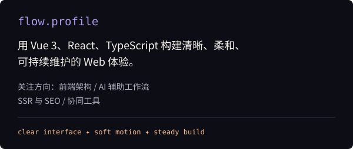
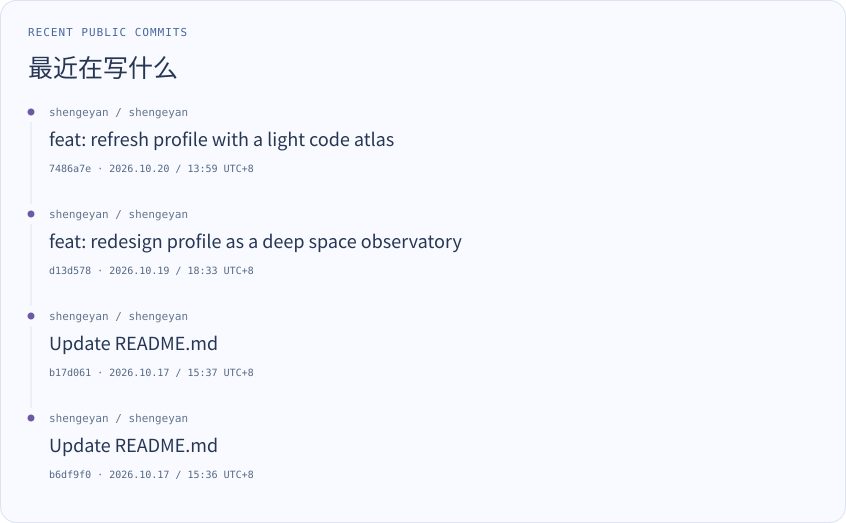
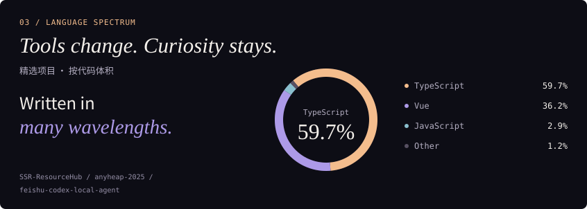
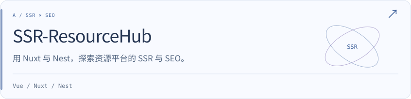
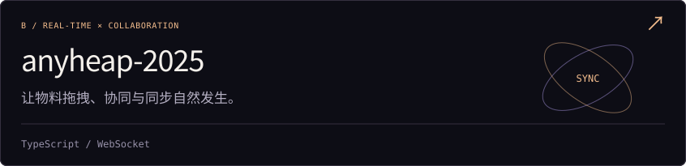
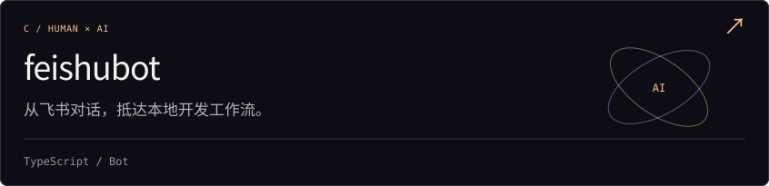

<picture>
  <source media="(max-width: 600px)" srcset="./assets/deep-space/hero-mobile.svg" />
  
</picture>

  

  <strong>中文</strong> |
  <a href="./README.en.md">English</a>

  
  
  

---

## 01 / 风向档案

<table>
  <tr>
    <td width="28%"><strong>名称</strong></td>
    <td><strong>ShenGeYan / 沈歌宴</strong></td>
  </tr>
  <tr>
    <td><strong>身份</strong></td>
    <td>Web 前端开发者 / 计算机科学与技术学生</td>
  </tr>
  <tr>
    <td><strong>坐标</strong></td>
    <td>重庆理工大学</td>
  </tr>
  <tr>
    <td><strong>方向</strong></td>
    <td>用前端、AI 和工程化，把想法打磨成清晰、柔和、可持续维护的产品。</td>
  </tr>
</table>

我喜欢有结构的复杂系统，也喜欢轻盈、有呼吸感的交互。近期主要围绕 **Vue 3**、**React**、**TypeScript**、**SSR/SEO**、协同工具和机器人工作流做探索。

---

## 02 / GitHub 潮汐

<picture>
  <source media="(max-width: 600px)" srcset="./assets/deep-space/atlas-mobile.svg" />
  
</picture>

  
  
  
  
  

  

<table>
  <tr>
    <th>信号</th>
    <th>说明</th>
  </tr>
  <tr>
    <td><strong>主要语言</strong></td>
    <td>TypeScript、JavaScript、Vue、HTML、Python、React</td>
  </tr>
  <tr>
    <td><strong>工程倾向</strong></td>
    <td>前端架构、产品交互、自动化流程、AI 辅助开发</td>
  </tr>
  <tr>
    <td><strong>开放方向</strong></td>
    <td>Web 应用、资源系统、协同体验、开发者工具</td>
  </tr>
</table>

<picture>
  <source media="(max-width: 600px)" srcset="./assets/deep-space/activity-cn-mobile.svg" />
  
</picture>

[查看完整提交信息与链接](./assets/deep-space/recent-commits.md)

---

## 03 / 技术流

  
  
  
  
  
  
  
  
  
  

<picture>
  <source media="(max-width: 600px)" srcset="./assets/deep-space/languages-cn-mobile.svg" />
  
</picture>

> 精选项目的语言占比按代码体积统计：SSR-ResourceHub、anyheap-2025、feishu-codex-local-agent。

---

## 04 / 项目浪潮

**Project Flow · Ideas Moving Like Water**

<a href="https://github.com/shengeyan/SSR-ResourceHub">
<picture>
  <source media="(max-width: 600px)" srcset="./assets/deep-space/project-1-cn-mobile.svg" />
  
</picture>
</a>

<a href="https://github.com/shengeyan/anyheap-2025">
<picture>
  <source media="(max-width: 600px)" srcset="./assets/deep-space/project-2-cn-mobile.svg" />
  
</picture>
</a>

<a href="https://github.com/shengeyan/feishu-codex-local-agent">
<picture>
  <source media="(max-width: 600px)" srcset="./assets/deep-space/project-3-cn-mobile.svg" />
  
</picture>
</a>

> `feishubot` 的现仓库名称为 `feishu-codex-local-agent`。六个项目的说明与技术栈均保留如下。

<table>
  <tr>
    <th>项目</th>
    <th>说明</th>
    <th>技术栈</th>
  </tr>
  <tr>
    <td><a href="https://github.com/shengeyan/SSR-ResourceHub"><strong>SSR-ResourceHub</strong></a></td>
    <td>毕业设计项目：用 SSR 优化资源系统 SEO，前端 Nuxt，后端 Nest。</td>
    <td><code>Vue</code> <code>Nuxt</code> <code>Nest</code></td>
  </tr>
  <tr>
    <td><a href="https://github.com/shengeyan/anyheap-2025"><strong>anyheap-2025</strong></a></td>
    <td>AnyHeap 2025 重制版：围绕物料拖拽、协同操作和同步体验重构。</td>
    <td><code>TypeScript</code> <code>WebSocket</code></td>
  </tr>
  <tr>
    <td><a href="https://github.com/shengeyan/feishu-codex-local-agent"><strong>feishubot</strong></a></td>
    <td>飞书对话 Codex 协作任务：把机器人接入开发协作流程。</td>
    <td><code>TypeScript</code> <code>Bot</code></td>
  </tr>
  <tr>
    <td><a href="https://github.com/shengeyan/DRSP-client"><strong>DRSP-client</strong></a></td>
    <td>配料表过敏源智能分析小程序前端仓库。</td>
    <td><code>JavaScript</code> <code>Mini Program</code></td>
  </tr>
  <tr>
    <td><a href="https://github.com/shengeyan/Mlysl-UI"><strong>Mlysl-UI</strong></a></td>
    <td>字节青训营组件库开发项目。</td>
    <td><code>TypeScript</code> <code>Vue</code></td>
  </tr>
  <tr>
    <td><a href="https://github.com/shengeyan/FrontMidPlatform"><strong>FrontMidPlatform</strong></a></td>
    <td>前中台前端开发项目。</td>
    <td><code>Vue</code></td>
  </tr>
</table>

  

---

## 05 / 联系

<table>
  <tr>
    <td><strong>Website / Blog</strong></td>
    <td><a href="https://shengeyan.github.io/">https://shengeyan.github.io/</a></td>
  </tr>
  <tr>
    <td><strong>Blog</strong></td>
    <td><a href="http://shengeyan.tuanwo.cn/">http://shengeyan.tuanwo.cn/</a></td>
  </tr>
  <tr>
    <td><strong>Email</strong></td>
    <td><a href="mailto:itshengeyan@qq.com">itshengeyan@qq.com</a></td>
  </tr>
</table>

  <strong>FLOW.ONLINE / 一起创造有趣的东西吧！</strong>

<picture>
  <source media="(max-width: 600px)" srcset="./assets/deep-space/footer-mobile.svg" />
  
</picture>

<!-- Profile artwork and public signals update daily; see scripts/README.md. -->
